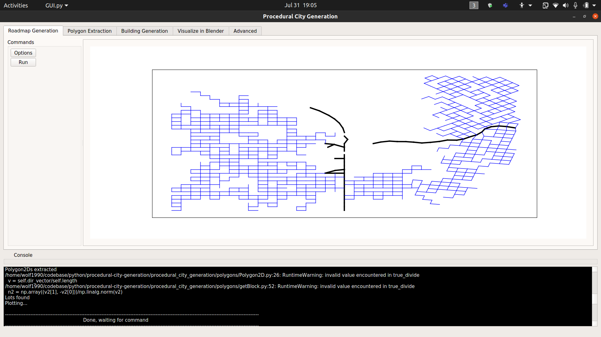
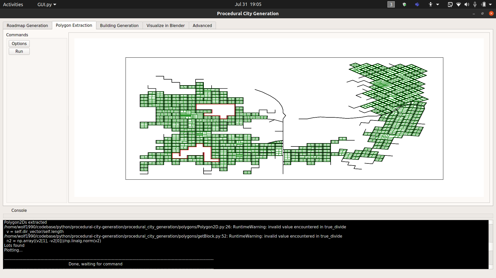
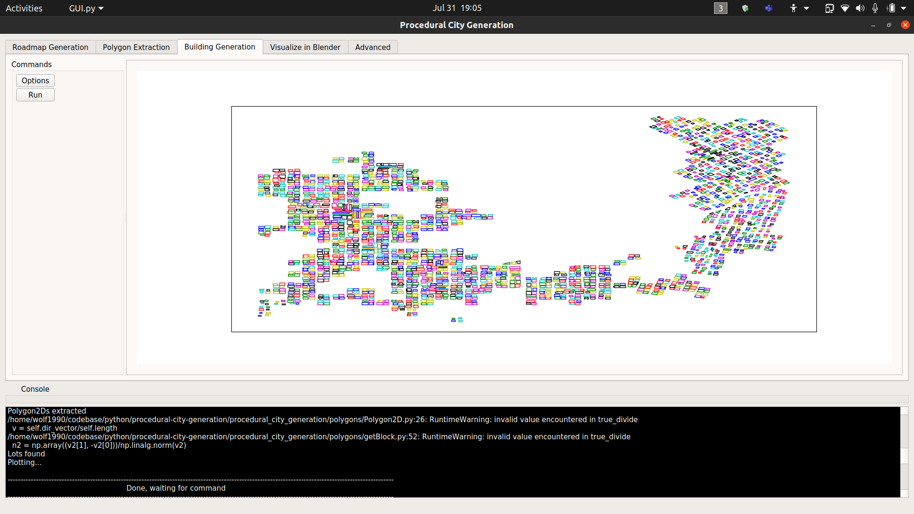
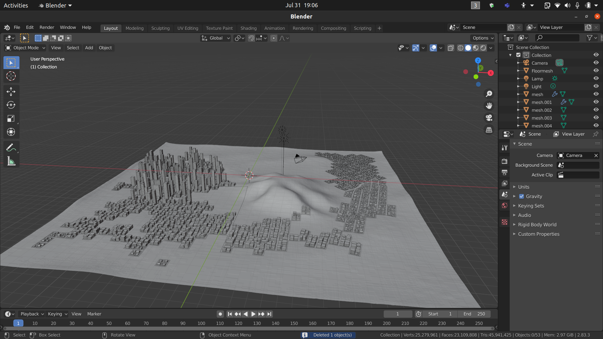

# Procedural City Generation

This is fork from [Procedural City Generation](https://github.com/josauder/procedural_city_generation). All credits go to by [josauder](https://github.com/josauder). Documentation can be found [here](http://josauder.github.io/procedural_city_generation).

#### Kindly open issues if you encounter bugs / need fixes.

---

## Dependencies

- pyqt5
- numpy
- matplotlib
- json
- pickle
- PIL
- scipy
- importlib
- pkgutil

## Running the program

> `python3 GUI.py`

## Common Issues

- **Missing `temp` or `outputs` folders**: The program expects `temp` and `outputs` directories inside `procedural_city_generation/`. If you encounter errors during the *Roadmap Generation* or subsequent steps, manually create these folders.
- **Blender not found**: If the *Visualize in Blender* tab throws `'blender' is not recognized as an internal or external command`, ensure Blender's installation path is added to your system's `PATH` environment variable. Restart your terminal/command prompt after updating the environment variable.
